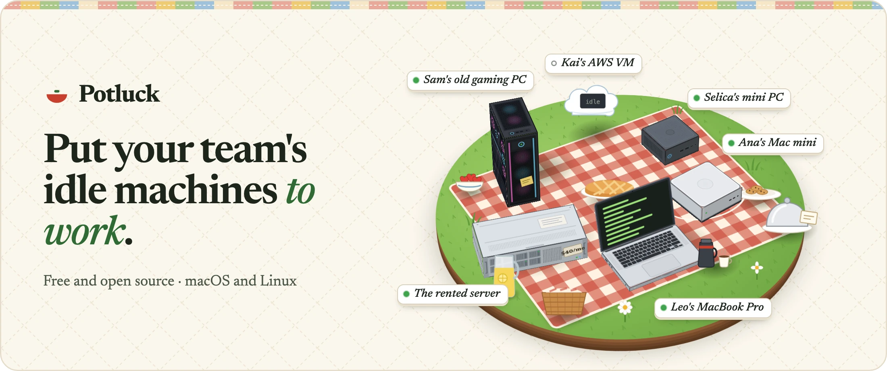

<h1 align="center">
  <a href="https://potluck.sh"></a>
</h1>

<p align="center">
  <a href="https://potluck.sh">Website</a> ·
  <a href="#quick-start">Quick start</a> ·
  <a href="docs/">Docs</a> ·
  <a href="https://potluck.sh/blog">Blog</a> ·
  <a href="https://mezze.sh">Mezze</a> ·
  <a href="https://github.com/sengirunners/potluck/discussions">Discussions</a>
</p>

<p align="center">
  <a href="https://github.com/sengirunners/potluck/actions/workflows/ci.yml"></a>
  <a href="https://github.com/sengirunners/potluck/actions/workflows/clean-machine-proof.yml"></a>
  <a href="https://github.com/sengirunners/potluck/releases/latest"></a>
  <a href="https://pkg.go.dev/github.com/sengirunners/potluck"></a>
  <a href="LICENSE"></a>
  <a href="https://glama.ai/mcp/servers/sengirunners/potluck"></a>
</p>

Potluck aims to put your team's idle machines to work. It will run your GitHub Actions jobs and your coding
agents in fresh VMs or sandboxed containers on Macs and Linux boxes you already own, and hand a machine back when
its owner returns. Pools will let people you invite lend machines too.

| Coding agents | GitHub Actions | Still your machine |
| --- | --- | --- |
| An agent's commands run in a throwaway sandbox on a pool machine, not on your laptop: `potluck sandbox create`, or the sandbox tools over [MCP](#mcp-for-agents). | `potluck ci pr <owner/repo>` prepares a pull request that changes one job's `runs-on`, so that job can run on a Mac you lend. Pull requests from forks keep GitHub's runner ([docs/ci-pr.md](docs/ci-pr.md)). | By default a Mac works for the pool only while its owner is away: touch the keyboard or trackpad and its job ends. `potluck host set drain` winds any machine down. |

## Status

> [!NOTE]
> Early. There is a `potluck` program (the daemon and the commands below), signed releases for macOS and Linux, and
> an install script. Interfaces will change. Did you run it before as zm? See [docs/coming-from-zm.md](docs/coming-from-zm.md).

## What you need

- **A machine that can run sandboxes.** On an Apple-silicon Mac: [Tart](https://tart.run/quick-start/) and
  [Softnet](https://github.com/openai/softnet/releases/latest) (setuid root; `potluck doctor` prints the one sudo line;
  on macOS 15, see [docs/softnet.md](docs/softnet.md)). On Linux: Docker with Kata or gVisor
  ([cmd/potluck-driver-tart/README.md](cmd/potluck-driver-tart/README.md) has the setup). `potluck doctor` tells you what is missing and
  where to get it.
- **To try it alone: nothing else.** No account, no second machine. The pool and the machine that shares are the
  same computer. A Mac needs about 60 GB free for the macOS image it pulls the first time.
- **For friends' machines: a way for machines to reach each other.** By default that is [Tailscale](https://tailscale.com/)
  (a free Tailscale account; Potluck has no accounts of its own). Instead of it, `--via tunnel` uses a tunnel you set up yourself (see "A tunnel instead of Tailscale" below).
- A second machine is optional, and is the point once you invite friends.

## How it works

- A **pool** is a group of machines you and your friends lend and use. One machine runs it (`potluck create`); friends join with
  a one-time code (`potluck invite`, `potluck join`).
- A **host** is a machine that shares some of itself with a pool (`potluck host`). Potluck checks it first, and it
  keeps what it shares to a fraction of its cores and RAM (half by default; `--share`).
- A **size** is the shape of one sandbox, such as `c1m2`: 1 core, 2 GB of RAM.
- A **sandbox** is a fresh VM or container on a host (`potluck sandbox create`). You run commands in it and then remove it.
- A **layer** is what makes the sandbox: Tart VMs on a Mac, Docker with Kata or gVisor on Linux. Potluck drives it through a
  small program called a driver, which you do not have to run yourself.
- One **daemon** per machine does the work. When a program built on Potluck already runs one, `potluck` uses it
  rather than starting its own ([docs/daemon.md](docs/daemon.md#one-daemon-per-machine)).

## Quick start

### Install

```sh
curl -fsSL https://raw.githubusercontent.com/sengirunners/potluck/main/install.sh | sh
```

macOS and Linux, no Go needed. The script puts `potluck`, its drivers, `potluck-conformance` and `potluck-e2b` in `~/.local/bin`. If that is not on
your PATH, it adds one line to your shell's startup file (`~/.zshrc` on a Mac), so a new terminal finds `potluck`
(`--no-modify-path` leaves startup files alone). Other ways to install, and what the script checks:

| You want | Do this |
| --- | --- |
| The newest release | the line above |
| To install and join a pool from an invite code | `curl -fsSL https://raw.githubusercontent.com/sengirunners/potluck/main/install.sh \| sh -s -- --join '<invite code>'` |
| A release you downloaded | `sh install.sh --from <dir>` ([docs/install.md](docs/install.md)) |
| A given release | `sh install.sh --version potluck-main-<12 hex>` |
| What the script checks | the release signature, with macOS's own `ssh-keygen` or OpenSSL 3, before anything runs ([docs/install.md](docs/install.md#what-is-checked)) |
| The Mac menu bar item (not Developer ID signed yet) | `sh install.sh --menubar` on a Mac ([docs/menubar.md](docs/menubar.md)) |
| Later releases | `potluck upgrade`, or once a day: `potluck upgrade enable` |
| To build from source | `go build -o ~/bin/ ./cmd/potluck ./cmd/potluck-driver-tart ./cmd/potluck-conformance` |

### Try it on one machine

```sh
potluck doctor                          # what this machine can share, and what is missing
potluck create trial --via tunnel       # a pool on this machine alone: no Tailscale, and no tunnel to set up
potluck host --reclaim-idle-s 0         # share this machine with that pool
potluck sandbox create                  # prints the sandbox's id
potluck sandbox exec <id> -- uname -a
potluck sandbox rm <id>
```

`--reclaim-idle-s 0` matters on a Mac you are sitting at: by default a Mac's sandbox ends when you touch the keyboard or
pointer, and starts only after the Mac has been idle for five minutes.

A session on a Mac looks like this. It is an illustration, not a recording: it follows what the commands print, with some lines left out (the image, the `GitHub Actions:` line, the `ran:` lines for each command Potluck runs, and notes), and the machine name, id and `uname` line are examples. The first `potluck host` on a Mac pulls a macOS image of about 27 GB and wants about 60 GB free:

```text
$ potluck create trial --via tunnel
potluck: started the daemon (~/.potluck)
pool trial is ready; this machine runs it
sealing: required (a new pool starts there: a machine too old to seal gets no secrets; potluck sealing lists them)
next: potluck invite <name> for a friend who runs sandboxes, potluck invite <name> --host for one who shares a machine
share this machine too: potluck host

$ potluck host --reclaim-idle-s 0
layer tart
quick check: the security checks once, a boot check per size (--full for the whole suite)
  shared mini-potluck-c2m4
shared with pool trial: mini-potluck-c2m4
members: potluck sandbox create

$ potluck sandbox create
mini-potluck-c2m4/a1b2c3 ready expires=2026-11-16T01:20:47Z net=on

$ potluck sandbox exec mini-potluck-c2m4/a1b2c3 -- uname -a
Darwin box 25.1.0 Darwin Kernel Version 25.1.0 arm64
$ potluck sandbox rm mini-potluck-c2m4/a1b2c3
removed mini-potluck-c2m4/a1b2c3
```

This path has been run end to end by hand many times on an Apple-silicon Mac with Tart. It is also tested in CI
with a stand-in for the VM layer (`cli/one_machine_test.go`) and has run by hand on a Linux VM with gVisor.

### With friends

On the machine that runs the pool. If you already made the `trial` pool above, this machine is in two pools once you
make `friends`: add `--pool friends` to the commands that pick a pool (`invite`, `host`, `sandbox create`).

```sh
potluck create friends       # the first time, prints a Tailscale login link and waits for you to sign in
potluck invite ana           # a link for a friend who runs sandboxes (add --pool friends if you made `trial`)
potluck invite carl --host   # a code for a friend who shares a machine (--trust public for a stranger; same --pool note)
```

`potluck invite ana` prints a link, `https://potluck.sh/join#v1.<code>`, and then the code. Send the link: the page
shows the friend one line that installs Potluck and joins (`curl -fsSL https://potluck.sh/install.sh | sh -s -- --join
'<link>'`). The code is in the part after `#`, which a browser never sends to the site. A friend who has Potluck
already runs `potluck join '<link or code>'`. Adding `--github` (on either line; the page offers it too) also signs
the friend in with GitHub at the pool's machine, through GitHub's own device flow, so a program that grants GitHub
logins there (zm's `zm grant @<login> ...`) reaches them; it is optional, and the invite works without it. Then, from any member's machine, the same
`potluck sandbox create`, `exec` and `rm` as above. Machines reach each other over Tailscale, or with `--via tunnel`
over a tunnel you set up (below). Potluck names a machine after its host name plus `-potluck` (`POTLUCK_MACHINE` overrides
it), so its tailnet node (`potluck-<machine>`) does not take the name of another daemon's node on the same machine.

### A tunnel instead of Tailscale

`--via tunnel` needs a public https address that forwards to a loopback port on the machine that runs the pool. Any
tunnel will do; this one uses Cloudflare's free quick tunnel (`cloudflared`):

```sh
cloudflared tunnel --url http://127.0.0.1:7435      # prints https://<random>.trycloudflare.com; leave it running, use a second terminal
```

Install `cloudflared` first (for example `brew install cloudflared`). Then add the `tunnel` key to `~/.potluck/config.json`
(`$POTLUCK_HOME/config.json` if you set it). The daemon has probably written that file already, so edit it rather than
replacing it, and keep its other keys:

```json
{"tunnel": {"listen": "127.0.0.1:7435", "url": "https://<random>.trycloudflare.com"}}
```

The daemon reads the file only when it starts, so restart it, then make the pool and an invite:

```sh
potluck daemon stop                   # skip if no daemon is running
potluck daemon --detach
potluck create friends --via tunnel
potluck invite ana --via tunnel --pool friends   # an https code (and its link): the friend needs no Tailscale
```

A quick tunnel's address changes each time it starts, so this suits a trial. This path runs every night, and within the
hour after each release, on a fresh GitHub-hosted Linux VM (`scripts/clean-machine-proof.sh`).

### Share compute

A friend with a `--host` code shares their machine with one command:

```sh
potluck host '<code>'
```

It checks the machine (a missing root step runs with sudo at a terminal, which asks for a password; `--no-sudo`
prints the one sudo line instead), pulls the pinned image for the layer, and runs a quick conformance check per
size. Only when a size passes does it join the pool with the code and share each size that passed; then it waits
until the pool lists them. A machine that fails never joins, and the code stays unspent. Before that, if you like:

```sh
potluck doctor                # what this machine can share, and the one root command it still needs
potluck host '<code>' --dry-run  # print the plan; pull, test and share nothing
```

Afterwards:

```sh
potluck isolation test <size> # prove its boxes cannot reach this machine, its LAN or tailnet (docs/isolation.md)
potluck host set drain        # wind down: nothing new starts, running work finishes (cut after 30 minutes by default)
potluck host set closed       # stop now (set auto to go back to your own rules)
potluck host pause            # stop lending for now, keeping what is shared (refused while work runs)
potluck host resume           # lend again after a pause, a wind-down or a stop now
potluck host stop             # stop sharing: remove every size potluck host shared from this machine
potluck host status           # what it lends and runs now, and whether it takes new work (changes nothing)
```

`--share` (default 0.5) sets the fraction of cores and RAM shared; on a Mac a sandbox ends when you touch the
keyboard or pointer (`--when away`, the default there; `--when any` shares all the time), and a run again keeps
the earlier choice. Run again with no code, `potluck host` shares with the only pool this machine is in; where
this machine already shares sizes with that pool and no flag changes the share, it only prints what it would do
and asks for `--yes`.
`--detach` does the checks and the admin step, then goes on in the background (`potluck host status` says how it
goes). `potluck host --help` lists the rest.

### Lending a Mac, and taking Potluck off it

[docs/lending.md](docs/lending.md) is the page for someone who lends a Mac and does not code: what setup puts on the
Mac and why, what the pool's members and its owner can and cannot do, what is not yet proven, and how to pause,
leave, remove a pool you created and remove everything.

To remove Potluck from a machine:

```sh
potluck host stop             # stop lending
potluck host images --remove  # on a Mac: delete old images Potluck pulled and no longer lends; yours are kept
potluck uninstall --dry-run   # what it would do, in order; changes nothing
potluck uninstall             # does it, after you type yes
```

`potluck uninstall` stops sharing, leaves the pools this machine joined, removes the managed Softnet (the one step that
asks for your password), stops the daemon, and removes the daily update job, the host override file, the line
`install.sh` added to your shell's startup file, the home (`~/.potluck`, unless `--keep-home`) and the programs. It
names what it leaves for you: Tart and its images (the current macOS image stays until you run `tart delete` on it), a
Softnet you installed yourself, the Tailscale node and the menu bar app. `potluck leave <pool>` leaves one pool you
joined, and `potluck disband <pool>` removes one you created (its members are cut off and told) while keeping the rest
of Potluck.

### More

`potluck --help` lists the rest: `leave`, `disband`, `uninstall`, `host stop`, `status`, `sandbox ls|shell|cp|push|extend|signal|stop|start`
(`sandbox create --persist` keeps a sandbox's disk while it is stopped), `usage`,
`run`, `agent-task` (a coding agent run once in a fresh sandbox, its commits back as a local ref:
[docs/agent-tasks.md](docs/agent-tasks.md)), `agent-runner` (a coding agent vendor's self-hosted runners in fresh sandboxes:
[docs/agent-runners.md](docs/agent-runners.md)) and `runners`.

- **Move a CI job onto a lent Mac:** `potluck ci pr <owner/repo>` changes one job's `runs-on` and prepares the pull
  request ([docs/ci-pr.md](docs/ci-pr.md)).
- **E2B's SDKs on your sandboxes:** `potluck-e2b` ([docs/daemon.md](docs/daemon.md#e2b-gateway)); skip it if you do not use E2B.

This flow is tested in CI with the reference driver standing in for the VM layer (`cli/cli_test.go`), and runs every night
and after each release on a fresh GitHub-hosted Linux VM with gVisor (`scripts/clean-machine-proof.sh`, the `clean-machine-proof`
workflow). Its one-machine part has been run by hand many times on an Apple-silicon Mac with Tart; it has not
yet been run across two machines.

## MCP for agents

Add Potluck to an MCP client's configuration:

```json
{"mcpServers":{"potluck":{"command":"potluck","args":["--pool","friends","mcp"]}}}
```

Start the daemon and join or create the pool first ([llms-install.md](llms-install.md) is the same setup, step by step, for an agent doing it for you). With one pool, `--pool` is optional.
The server exposes only sandbox tools: create, execute, list, extend, stop, restart,
delete, background processes and file reads/writes. Output from a sandbox is untrusted data.
It uses `$POTLUCK_HOME` and your local identity; `POTLUCK_AS` (or `mcp --as`) selects a caller
address, and `POTLUCK_TOKEN` supplies a restricted token. It does not inherit another program's
identity variables. Tool discovery works with no daemon; tool calls report the missing daemon.
All standard output is MCP protocol traffic.

### Claude Code plugin and Agent Skill

[`plugin/skills/potluck/SKILL.md`](plugin/skills/potluck/SKILL.md) teaches a coding agent to set up Potluck and use its sandboxes.
In Claude Code, the plugin installs that skill and the MCP server together:

```text
/plugin marketplace add sengirunners/potluck
/plugin install potluck@potluck
```

Other agents that read Agent Skills (Codex, Gemini CLI, Cursor, Copilot) can use the same `SKILL.md`.

## What works today

| Works today | Not yet |
| --- | --- |
| `go build`, `go vet`, `go test` in CI on Linux; signed releases and `install.sh`; a daily upgrade job (`potluck upgrade enable`) | |
| OCI and Incus layers tested against stand-in CLIs; Tart through a fake layer | Tests on real VMs in CI (a manual run) |
| The quick start on a fresh GitHub-hosted Linux VM with no earlier Potluck or zm on it, every night and after each release (the `clean-machine-proof` workflow): install, a pool over a Cloudflare quick tunnel, the VM shared through gVisor, a sandbox and `potluck run` | The quick start across two real machines in CI |
| The one-machine quick start on an Apple-silicon Mac with Tart, run end to end by hand many times | |
| The VM driver passes the full suite over a fake layer (isolation is not exercised there) | |
| Every check the reference driver passes is also shown to fail on a driver broken on purpose | |
| A real GitHub Actions job run through the broker, by hand: on a Mac (Tart, the same machine as the broker) and on a Linux box on another machine (OCI with gVisor) | Actions jobs on pool machines in our own CI, every day |
| VMs end at their deadline even if the daemon is down | Commands sealed to the host's key |
| Hand-back on a Mac when its owner types or moves the pointer | On Linux, hand-back when the owner returns (a time window only, today) |

When an owner takes a machine back, running VMs are ended and new work is refused.

## What you should know before trusting it

- The machine that runs a VM can read everything in it: your code, your commands, their output and any secrets.
- The machine that runs a pool can read commands, output and secrets passing through it, until commands are
  sealed to the host's key. Join only a pool whose owner you would trust with them.
- A coding agent vendor's key handed to `potluck agent-runner` can be read by the machine that runs the box and by
  the agent's session in it ([docs/agent-runners.md](docs/agent-runners.md)); so can a credential handed to
  `potluck agent-task` ([docs/agent-tasks.md](docs/agent-tasks.md)).
- Conformance proves a driver behaves. It does not prove its author can be trusted. A run can also pass with
  checks skipped (the network checks need flags), so read the SKIP lines.
- On the OCI layer, the default is no network at all. A box with a network relies on a firewall the host's owner
  sets up. The driver cannot read firewall rules: naming the network is the owner's word that it is filtered.
- Use at your own risk. There are no promises.

## Macs

Apple's macOS licence allows up to two macOS VMs on a Mac you own or control, for uses such as development,
testing and personal use, and does not allow time-sharing or service-bureau use. Potluck caps macOS guests at two
per Mac and does not check the rest. Our rule: lending a macOS guest to people on your
team or friends you invite is fine, the same as letting a colleague use your Mac for a few minutes, and so is a
GitHub Actions job from another org that runs in a macOS guest on a Mac lent to the pool. Selling Mac time to the
public is not, and neither is pooling iOS Simulator time. Linux guests on a Mac are not
affected. Read the licence yourself; this is not legal advice.

Tart is a separate program under FSL-1.1-ALv2. You install it and accept its licence yourself; Potluck does not
bundle it.

## What Potluck is not

- Not a hosted cloud. It runs on machines you own.
- Not a sandbox runtime of its own. It drives Tart, Kata, gVisor and Incus.
- Not a scheduler for clusters.

Where things are in the source: [docs/layout.md](docs/layout.md).

## Build and test

```sh
go build ./...
go vet ./...
go test ./...               # includes the suite against the reference driver and its broken variants
go test ./conformance/...   # just the suite's own tests
```

To check a real driver, build `cmd/potluck-conformance` and point it at a throwaway binding. It makes and ends
real resources. `potluck-conformance --print-probe` prints the probe script your test commit must hold. The setup
for each layer and an example run are in [cmd/potluck-driver-tart/README.md](cmd/potluck-driver-tart/README.md).

## Contributing

See [CONTRIBUTING.md](CONTRIBUTING.md). Report security problems as [SECURITY.md](SECURITY.md) says, not in a
public issue.

## Mezze

Running a team of coding agents on Potluck? [Mezze: mail and work items for coding agents](https://mezze.sh) is a separate product from the same makers that runs on Potluck: mail between agents and people, and work items whose claims expire.

## Sengi

Potluck is made by [Sengi, Inc.](https://sengi.run), which sells hosted GitHub Actions runners. Potluck runs without
Sengi and without a Sengi account.

## Licence

Copyright 2026 Sengi, Inc. Apache-2.0. See [LICENSE](LICENSE) and [NOTICE](NOTICE).
